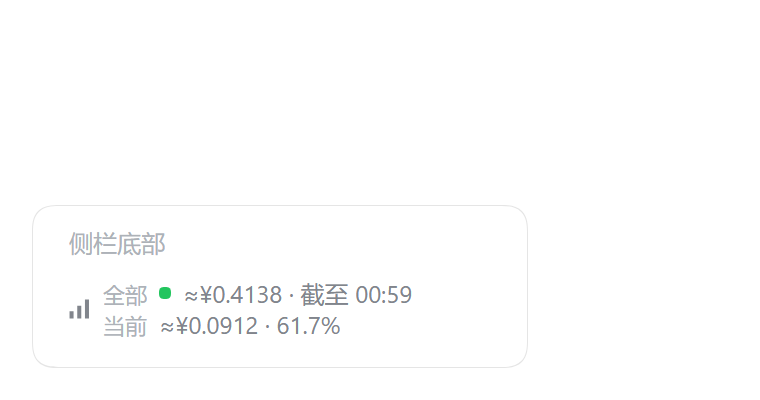
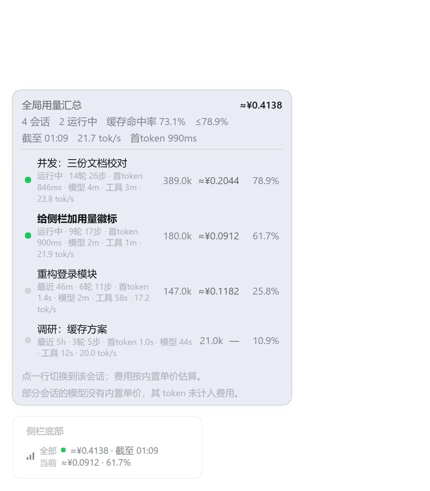
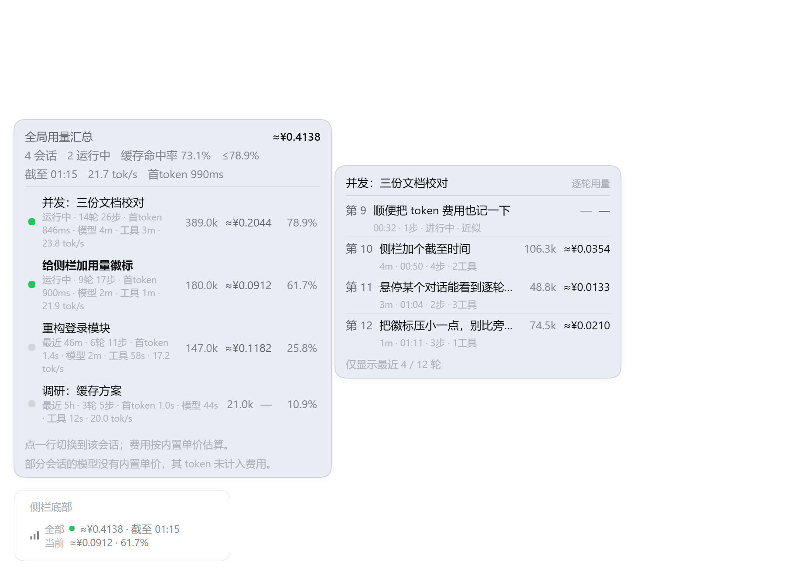
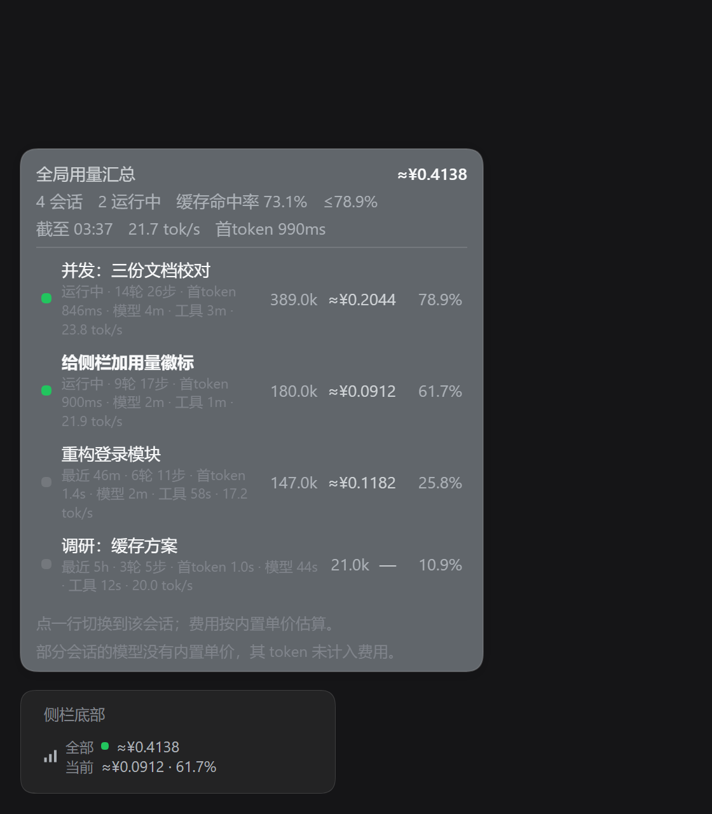

# dsh-token-cost

简体中文 · [English（精简版）](README.en.md)

侧栏底部常驻的**用量与费用账本**：全部会话合计 + 当前任务（有任务在跑时金额前一个绿点）。
这份账目的**截至时刻**只在悬停展开的面板里显示。费用按可编辑的价目表估算；插件不新增任何模型调用、提示词或工具。

[](https://github.com/wojiao42/dsh-token-cost/releases)
[](LICENSE)

## 截图

| 侧栏底部（两行徽标） | 明细面板（悬停展开） |
|---|---|
|  |  |
| 悬停某个对话行 → 逐轮用量 | 深色主题 |
|  |  |

> 截图由 `node tools/render-panel.mjs` 生成：把**真实组件**渲染成 HTML（主题变量取自本机安装的
> `dsh-client-ui-theme`，用 `node tools/extract-theme.cjs` 抽出），再用无头 Chrome 出图。
> **图中的任务是虚构样本**，不是任何人的真实用量与费用。

## 快速上手

1. 装：设置（Ctrl+,）→ 插件市场 → 自定义安装 → 填 `github:wojiao42/dsh-token-cost`（桌面端推荐，命令行装法见「安装」），装完重启 DSH。
2. 看侧栏底部那两行：全部会话（有任务在跑时前面有个绿点）/ 当前任务；**悬停**展开明细，点一下可钉住。
3. 再**悬停某一行**看该会话的逐轮用量；某些后台任务还没取到数据时，点底部 **「载入其余会话 · N」**。

逐轮用量由 Host 半侧提供：**改过 `index.js` 后需要重启一次 Harness**（客户端会提示）。

## 功能

### 徽标与面板

```
全部 ●≈¥0.1240
当前  ≈¥0.0330 · 45.4%
```

**鼠标悬停**展开逐会话明细（移开自动收起，点一下可钉住）。每个任务两行：

- 第一行：状态圆点 / 标题 / token / 费用 / 上下文占用百分比 —— **当前任务加粗**，点行切换会话，运行中排最前；
- 第二行（时间）：`运行中 12m` 或 `最近 3m`、轮/步、平均首 token、模型耗时、工具耗时、解码 `tok/s`。

| 元素 | 内容 |
|---|---|
| 徽标第一行 | `全部 ≈¥0.12`：全部会话的估算费用合计（有任务在跑时金额前有一个绿点）；截至时刻不在这里 |
| 徽标第二行 | `当前 ≈¥0.03 · 45.4%`：主视图里那个任务的费用 + 上下文占用 |
| 徽标尺寸 | 两行、12px 行高 1.25——侧栏 footer 是单行 flex 槽位，故意压到与旁边的单行按钮同一量级 |
| 展开方式 | **悬停**即展开（移开 0.2 秒后收起）；点击钉住 / 取消钉住；键盘 focus 同样展开 |
| 面板头部 | 合计金额；元信息：会话数 / 运行中数 / 缓存命中率 / 最高占用 / **截至时刻 / 整体 tok/s / 平均首 token** |
| 面板列表 | 每行两行：标题行（圆点、标题、token、费用、占用%）+ **时间行**（见下） |
| 词条 | `运行中 12m` / `最近 3m` · `7轮 12步` · `首token 1.2s` · `模型 4m` · `工具 3m` · `23.8 tok/s` |
| 面板底部 | 「载入其余会话 · N」（仅在还有会话没取到数据时出现） |

### 逐轮预览

**悬停某一个对话行**，在**那一行右侧**再弹一层该会话的**逐轮用量**：每轮一行 = 轮号 + **触发它那句话**，
下面一行是 `用时 · 时刻 · 步数 · 工具数`；有重试标「近似」、未闭合标「进行中」、用量不可证明时显示 `—`。
**点某一轮会切到该会话并把主视图落到那一轮**。数据来自该会话的日志（Host 半侧读），
折叠由本插件自己实现（`foldTurns` / `foldTurnUsage`，按轮累加 provider 上报的用量）。

### 为什么只有侧栏一处

侧栏收起时降级为只显示合计金额。输入框下方**刻意不显示任何东西**——同一份合计不重复出现。
早期版本在输入框下方也有一个「本会话」药丸，两处显示同一类数字属于重复；现在只保留侧栏一处，
把「全部」与「当前」并排放在同一块。

### 官方余额对账

面板的 meta 行会显示 **官方余额**（¥）和 **对账差**。Host 每次查余额时，把「官方余额」和面板上的「本地估算合计」一起记进账本（`$DSH_HOME/token-cost/ledger.json`），有两次以上快照就能算出：

- 这段时间官方扣了多少：`balanceFrom − balanceTo`
- 本地估算涨了多少：`localTo − localFrom`
- 差多少：`+` 表示本地多算，`−` 表示本地少算

余额要联网才查（默认关闭，见「口径与安全设计 › 联网与凭据」）；只有一次快照时不显示对账差。

### 投影缺失时的兜底

侧栏列表里的会话用量来自 Host 的投影缓存。历史会话、冷会话、或投影缓存被清掉之后，这些会话没有 `tokenUsage` 投影 —— 面板上就会出现「token 0 / 费用 —」的横线。

现在面板会对这类会话逐个问 Host 的 `GET /token-cost/session-usage?sessionId=…`：Host 直接读该会话日志里 `assistant/message` 上报的 `usage` 累加（和逐轮预览同一套数据源），顺便把模型名带回来，所以费用也能算。取数并发 4、结果缓存 60 秒；拿不到就仍然显示横线，不猜。

## 口径与安全设计

### 数据从哪来

- **不新增任何模型调用、提示词或工具**：全部来自已有会话投影
  （`tokenUsage` / `contextPressure` / `modelSelection`，估算器就是官方 `dsh-token-meter`）。
- **上下文占用** = `contextPressure.projectedTokens / contextWindow`，与内置的上下文圆环同源。
- **冷会话取证**：Host 的控制基线只覆盖当前活跃 Session，后台任务/其他窗口的会话是冷会话，
  列表里没有它们的投影。插件对缺数据的会话调用客户端已有的
  `ctx.sessions.refreshProjections(id)`（官方语义：**不打开会话也能读它的全部投影**），
  顺序是**运行中优先**、其次按最近更新；每次列表更新最多取 48 个，取过的不重复请求；
  打开面板时会重试仍缺数据的会话。
- **取不到的会话**：已删除/已归档、不在会话列表里的会话没有数据，不计入合计。
- **合计和当前会话对不上**：合计包含所有会话（含后台任务与子智能体）。冷会话第一次要按需取证，
  几毫秒内补齐；还没补齐时面板底部会出现「载入其余会话 · N」。
- **会发额外请求吗**：不发模型请求。只在客户端向本机 Host 读会话投影
  （冷会话取证走的是官方 `session.projections` 接口）。

### 时间信息从哪来

| 显示 | 来源 | 精度 |
|---|---|---|
| `截至 HH:MM` | 会话列表里**有用量会话的最近活动时间**（`updatedAt`）取最大值 | 与 Host 的列表更新同源 |
| `运行中 12m` | 客户端**首次观察到该会话处于运行中**的时刻起算，面板打开时逐秒刷新 | 近似（页面打开后才开始计时；刷新页面重新起算） |
| `最近 3m` | `updatedAt` 到现在的相对时间 | 同上 |
| 轮/步、首 token、模型耗时、工具耗时 | 官方 `sessionStats` 投影（`turns` / `steps` / `ttftMs` / `ttftSteps` / `llmMs` / `toolMs`） | 精确：按会话日志折叠，压缩与分页都不影响 |
| 解码 `tok/s` | `sessionStats.decodeTokens / decodeMs` | 精确 |

**没有的东西**：投影里不带「本次运行开始的绝对时刻」，所以运行时长的起点只能用客户端观察值近似。
「今日花费 / 近 5 分钟花费」这类按时间分桶的账目需要事件时间，现有投影不提供。

### 逐轮用量从哪来

| 项 | 做法 |
|---|---|
| 数据源 | 该会话的**日志事件**：Host 半侧用 `ctx.sessionQuery.readSession()` 读（冷会话走持久化日志，活跃会话走 live 分支） |
| 折叠 | 折叠由本插件自己实现（`foldTurns` / `foldTurnUsage`，按轮累加 provider 在 `assistant/message` 上报的 `usage`），`usage` 为 `null` 时表示该轮用量无法证明，与官方折叠语义一致 |
| 接口 | `GET /token-cost/turns?sessionId=<id>&limit=200[&refresh=1]` |
| 缓存 | Host 侧按会话缓存 15 秒，客户端再缓存 15 秒；悬停有 140ms 防抖，指针扫过不会连发请求 |
| 返回范围 | `limit` 默认 200、上限 200；v1.7.0 起预览默认返回全部轮次，不再截断到最近 30 轮；回包带 `totalTurns` 与 `truncated` |
| 显示 `—` | 折叠在「活动未闭合 / 计数不安全 / 与总量矛盾」时判定不可用，插件照原样显示，不猜 |

> **改过 `index.js` 必须重启 Harness 一次**（Host 模块不参与热重载，`dsh-hmr` 只做组合层）。
> 重启前客户端会显示「逐轮数据需要重启一次 Harness」。

### 单价与费用

费用 = 未缓存输入 × `cacheMiss` +（缓存读 + 缓存写）× `cacheHit` + 输出 × `output`，按当前模型查表。

官方自 **2026-09-10** 起改成分时定价（高峰 / 空闲两档，空闲价是高峰的一半），表也跟着分档，表在 `client.js` 顶部：

```js
const PRICES = {
  'deepseek-flash': {
    idle: { cacheHit: 0.02, cacheMiss: 1, output: 4 },
    peak: { cacheHit: 0.04, cacheMiss: 2, output: 8 },
  },
  'deepseek-v4-pro': {
    idle: { cacheHit: 0.15, cacheMiss: 4.5, output: 13.5 },
    peak: { cacheHit: 0.3, cacheMiss: 9, output: 27 },
  },
};
```

单位是**人民币元 / 每百万 token**。高峰 = **北京时间周一至周五 09:00–12:00、14:00–18:00**，
其余时段（含周末全天）按空闲价。判定用的是每一轮 / 每个会话的时间戳：一轮跨档位时按**开始时间**算，
会话合计按**最后活动时间**算，所以跨档位的长会话会有小额误差。

> **中国法定节假日没有判断**（没有节假日表），节假日当天会按工作日算成高峰 —— 只会多算，不会少算。
> 单价来源：<https://api-docs.deepseek.com/zh-cn/quick_start/pricing/>

表里没有的模型只显示 token 与占用，费用列显示 `—` 并在面板里提示未计入。

> **这是估算值，不是账单。** 插件只统计模型调用的 token 费用，**网页搜索 / 抓取**
> （Search、Fetch 各 5 元 / 1000 次）不计入；折扣、赠送额度、图片/文件计价也感知不到。
> 另外 `dsh-token-meter` 的文本计量本身是「每 token 四字符」的固定启发式，对 CJK 与 JSON 会低估。
> 要对账请以官方账单为准，或直接改上面那张表。

### 联网与凭据

默认**不联网**。要开「计价自动更新」和「官方余额对账」，在 profile 的 patch 层给这个插件加一段配置（`cordis.patch.yml`）：

```yaml
- id: token-cost
  name: dsh-token-cost
  config:
    network:
      pricing: true    # 每 24h 拉一次 pricing.json：官方调价后不用等插件发版
      balance: true    # 打开面板时查官方余额（60s 缓存）
    balance:
      readCredentials: true  # 没配 apiKey、环境变量也没有时，才去读 DSH 凭据库
```

开启后只访问两个地址：`raw.githubusercontent.com` 上的 `pricing.json`（取价目表）和 `api.deepseek.com/user/balance`（取余额）。API key 的查找顺序：

1. `balance.apiKey`（配置里直接写）
2. 环境变量（默认 `DEEPSEEK_API_KEY`，可用 `balance.apiKeyEnv` 改名）
3. `readCredentials: true` 时，读 `$DSH_HOME/.credentials.yaml` 里同名 ref

三处都拿不到就只显示 `—`，**不会**发请求。key 只在查余额时当 `Authorization` 头用，不落盘、不进日志。

### 计价规则自动更新

### 费用是按「每一次请求」算的

面板上每个会话的 ¥ 不再用「会话最后活动时间」套一个档位，而是由 Host **逐个 `assistant/message` 事件**按它自己的时间取高峰/空闲档、按当时的模型取价再累加（新路由 `GET /token-cost/costs?ids=…`，批量 40 个、缓存 10 分钟）。

原因很实际：投影里只有整会话的 token 汇总，没有时间分布。一个会话如果从空闲时段跨进高峰时段（或反之），用「最后活动时间」给整段定价会 ×2 或 ÷2。实测有个 10-06 的会话：291 个事件在空闲档、3 个在高峰档，按最后活动时间算成 ¥5.92，逐事件真值 ¥3.00。

价目表在仓库根目录的 `pricing.json`（含模型单价、高峰/空闲规则、更新时间和来源链接）。Host 每 24 小时拉一次，缓存到 `$DSH_HOME/token-cost/pricing.json`；远程拿不到就退回缓存，再退回插件内置表。所以官方调价后只要改一次 `pricing.json`，所有用户下一次打开面板就用新价，**不用等插件发版**。

## 安装

### 图形界面（桌面端，推荐）

设置（Ctrl+,）→ 插件市场 → 自定义安装 → 填 `github:wojiao42/dsh-token-cost` → 重启 DSH。

> 桌面端的 profile 由应用托管：直接跑 `dsh plugin --profile desktop add` 可能被拒绝，遇到就走上一步。

### 命令行（Web profile）

```sh
dsh plugin --profile web add github:wojiao42/dsh-token-cost
```

装完刷新页面。卸载：在插件市场里把 `dsh-token-cost` 移除即可。

### 本地源码开发

插件市场 → 自定义安装 → 填本机绝对路径；改完按下面「改完代码怎么生效」重启/重装。

| 位置 | 说明 |
|---|---|
| `<工作区根>\plugins\dsh-token-cost` | **源码**，改这里 |
| `<插件安装根>\dsh-token-cost` | 指向源码目录的目录联接（junction），作为安装源路径 |
| `…\.dsh\profiles\desktop\node_modules\dsh-token-cost` | 指向 `<插件安装根>\…` 的目录联接 |

profile 的 `package.json` 里登记为组合包（**必须**用 pnpm 的 `link:` 协议，
`file:` 会把目录硬链/复制进 `node_modules`，之后改源码不生效）：

```json
"dependencies": { "dsh-token-cost": "link:<插件安装根>/dsh-token-cost" },
"dsh": { "profile": { "bundles": [ "…", "dsh-token-cost" ] } }
```

### 仓库结构

| 文件 | 作用 |
|---|---|
| `package.json` | 插件清单：`dsh.bundle.patch` 与 `dsh.client`（`platform: web`、`immediately`、`inject: dsh-client-ui-sidebar`） |
| `index.js` | Host 半侧：注册 `GET /token-cost/turns`，按需读会话日志并折叠出逐轮用量（改动需重启一次 Harness） |
| `client.js` | 浏览器半侧：侧栏两行徽标 + 明细面板（构建产物直接提交，git 安装不跑构建） |
| `cordis.patch.yml` | 组合包 patch：插入 `token-cost` 行（`name` 必须等于包名） |
| `tools/plugin-summary-test.cjs` | 49 项离线断言（假 React/ReactDOM/hook harness，不需要浏览器） |
| `tools/turns-test.mjs` | 36 项离线断言：逐轮切分 + 折叠接线 + 路由契约（假 ctx / 假 sessionQuery） |
| `tools/verify-live.cjs` | 检查运行中的 Host 是否已在提供当前版本 |
| `tools/extract-theme.cjs` | 从本机 `app.asar` 抽出主题样式表（纯 node 读 asar），供出图用 |
| `tools/render-panel.mjs` | 把真实组件渲染成 HTML + 无头 Chrome 出商店截图 |
| `tools/lib/harness.mjs` | 离线 harness：假 React/ReactDOM + `client.js` 加载器 |
| `tools/publish.mjs` | GitHub 侧发布：建仓 + 推送 + topic + 收录条目，见 `PUBLISHING.md` |
| `screenshots.json` · `assets/` | 商店页截图声明与图片 |

### 改完代码怎么生效

客户端 bundle 在**条目被移除后重新加入**时才会重新读文件（`artifactRevision` 只看
mtime/ctime/size），所以改完 `client.js` 要重挂一次这个包：

1. **不重启（推荐）**：侧栏「插件」页找到 `dsh-token-cost`，开关**关掉再打开**。
2. **等价的文件做法**：把该包从 profile 的 `dsh.profile.bundles` 里删掉，等几秒
   （`dsh-hmr` 会重新组合 profile，旧 rev 立刻 404），再加回末尾。

**Host 半侧 `index.js` 改动必须重启 Harness**：Node 的 ESM 模块缓存按文件 URL 命中，
重挂组合包不会重新求值 Host 模块（DSH 也禁用了模块根热重载）。客户端在路由 404 时会提示这件事。

## 自测

```
node tools/plugin-summary-test.cjs   # 49 项：注册面、两行徽标、当前任务标记、
                                     #   金额算式、排序、未知模型、冷会话取证、
                                     #   载入其余、空列表、注入源、时间明细、
                                     #   悬停展开、逐轮预览取数
node tools/turns-test.mjs            # 36 项：逐轮切分、折叠接线、路由契约
node tools/verify-live.cjs           # 运行中的 Host 是否已在提供当前版本
```

三个脚本的退出码都必须为 0。前两个完全离线，`verify-live.cjs` 需要本机有正在运行的 DSH。

## 兼容

- **DSH Desktop / DSH Web 都能用**：客户端半侧声明 `platform: web`，注入点是侧栏
  `@deepseek-ai/dsh-client-ui-sidebar`；需要目标 DSH 支持组合包（`dsh.bundle.patch`）。
- **Node**：`package.json` 没有声明 `engines`。Host 半侧是 ESM 模块，只用平台注入的 `ctx`，
  没有原生模块、没有构建步骤；本机实测运行时是 Node v24.21.0。
- **平台**：截图与自测都在本机 Windows 上生成/跑过，代码里没有平台相关的原生依赖。

## 已知边界

- **已删除/已归档、不在会话列表里的会话取不到数据**，不计入合计。
- **上下文占用是参考值**：`projectedTokens` 含启发式误差，与内置圆环同源，不等于计费规模。
- **每次列表更新最多自动取证 48 个冷会话**，其余需要点一次「载入其余会话」。
- **对账要两次以上快照才有数。** 第一次查余额只记录基线；同一个 API key 被别的程序、别的机器用掉的钱也会算进余额差，所以偏差不一定是本插件算错。
- **法定节假日按工作日算。** 没有节假日表，节假日当天会按高峰价算 —— 只会多算，不会少算。

## 版本

最新在最上。

- **v2.5.1**（2026-11-08）：面板高度回调（330×340 太矮，会话列表只剩 5～6 行）→ **340 宽、最高 480px**，列表可视高度 320px（约 11 行）。

- **v2.5.0**（2026-11-08）：**本机累计改成 Host 侧权威值** + **面板瘦身**。① 之前「本机累计」用的是客户端合计，它只覆盖已加载投影的会话，冷启动时会严重偏小（实测只算到 ¥13，官方 ¥96.9），导致账本显示 86% 的假偏差；现在 Host 直接扫 `$DSH_HOME/sessions` 下全部会话日志逐事件算（缓存 10 分钟，导出 `invalidateLocalTotalCache()` 可手动刷新）。② 面板尺寸 364×520 → **330×340**，账本压成两行（消耗行 / 额度余额行），会话列表限高 168px 可滚动。

- **v2.4.1**（2026-11-08）：修面板展开瞬间崩溃（`Cannot read properties of undefined (reading 'gap')`）。v2.2.0 起余额查询走 Platform 汇总，返回结构里没有旧的 `drift` 字段，而面板 meta 行还按 `net.drift !== null` 判断——`undefined !== null` 成立，于是读 `net.drift.gap` 抛错、徽标整个从侧栏消失。改为同时判 undefined；展开面板会正常显示账本。

- **v2.4.0**（2026-11-08）：**账本定稿**。面板「账本」区分四组科目——**额度**（充值合计 / 赠送合计 / 总额度）、**消耗**（官方累计消耗 / 本机累计消耗 / 双边差额）、**余额**（官方余额 / 本机预估余额）、**账本**（最近校对 / 校对状态 / 账本备份）。校对状态按 |双边差额| ÷ 官方累计消耗 判定：≤2% 正常、≤5% 轻微偏差、>5% 偏差偏大。备份在 `$DSH_HOME/token-cost/backups/ledger-<日期>.json`（每天一份，面板显示份数与最近一份文件名）。

- **v2.3.0**（2026-11-08）：面板加「账本」区（一次余额查询即可显示）：**总额度（充值+赠送）/ 官方已花 / 本地预估 / 偏差 / 官方余额（充值、赠送拆分）/ 预估余额**；`balance.rechargeTotal` 配了历史充值总额时，总额度会拆成「充值 / 赠送」。平台快照同时写入账本（含 `officialTotalCost`）并**每天落一份备份** `$DSH_HOME/token-cost/backups/ledger-<日期>.json`，便于事后核对与校验。


- **v2.2.0**（2026-11-08）：**用官方的「累计花费」直接对账**。新增 `balance.readCredentials` 下读取 DSH 凭据库里的 Platform 授权令牌（`deepseek-account-platform/default`），调 `platform.deepseek.com/api/v0/users/get_user_summary` 拿到 ① 充值余额 ② 赠送余额 ③ **total_costs（官方累计花费）**。面板 meta 行显示「官方累计 ¥x / 本地累计 ¥y / 差 ±¥z」，一次读取就能对账，不再需要等两个快照。实测本机：官方累计 ¥94.18、本地逐事件 ¥91.68（少算 2.7%）、充值余额 ¥19.12、赠送余额 ¥0 → 反推赠送过 ¥13.29（充值 100）。


- **v2.1.2**（2026-11-08）：余额行在有赠送余额时显示拆分（`赠送 ¥x / 充值 ¥y`）。因为「充值 − 余额」不等于真实花费——赠送余额优先扣减，不看拆分容易把差额误记成插件算错。


- **v2.1.1**（2026-11-08）：**对账只在同一算法的快照之间算**。升级 v2.1.0 后「本地累计」的量纲从旧近似值（¥7 级）变成逐事件真值（¥90 级），跨算法相减会得到一个荒谬的对账差（+¥79.86）。现在每个账本快照带 `algo` 标记，`driftOf()` 只取最近同算法快照；没有标记的历史快照一律不参与。


- **v2.1.0**（2026-11-08）：**费用改为逐事件定价**。之前按「会话最后活动时间」给整段用量套一个高峰/空闲档，跨档位的会话会被算成 2 倍或一半（实测一个会话 ¥5.92 → ¥3.00）。现在 Host 按每个 `assistant/message` 自己的时间与当时的模型逐笔累加，新增 `GET /token-cost/costs?ids=…` 批量接口（40 个/次、10 分钟缓存），面板与徽标改用真实费用。
版本号取自各提交里的 `package.json`，日期是 git 提交日期。

- **v2.0.1**（2026-11-08）：投影缺失的历史/冷会话不再显示「token 0 / 费用 —」—— 面板改问 Host 的 `/token-cost/session-usage`，由 Host 直接从会话日志里累加 provider 上报的 usage 并带回模型名（并发 4、缓存 60s，取不到就不显示）。

- **v2.0.0**（2026-11-08）：新增两件联网能力（默认关闭）—— ① **计价规则自动更新**：价目表抽成仓库根的 `pricing.json`，Host 每 24h 拉一次并缓存，官方调价后不用等发版；② **官方余额对账**：面板显示官方余额与「本地估算 vs 官方扣费」的偏差，账本落在 `$DSH_HOME/token-cost/ledger.json`。API key 查找顺序：配置 → 环境变量 → （显式允许时）DSH 凭据库。新增路由 `/token-cost/pricing`、`/token-cost/balance`。

- **v1.8.0**（2026-11-08）：费用从「单一价格」改为**官方分时定价**（高峰/空闲两档）——`deepseek-flash` 空闲 1/4/0.02 元、高峰 2/8/0.04 元（缓存未命中/输出/缓存命中，每百万 token）；`deepseek-v4-pro` 改为自己的真实单价（空闲 4.5/13.5/0.15、高峰 9/27/0.3）。此前表里 flash 与 pro 同价、且缓存未命中按 0.4 元算，导致金额明显偏低。高峰判定按北京时间周一至周五 09:00–12:00、14:00–18:00；法定节假日不判断（只会多算）。

- **v1.7.2**（2026-10-08）：逐轮预览不再截断到最近 30 轮，面板可滚动，早轮也能点到。
- **v1.7.1**（2026-10-08）：徽标底色只在悬停时出现，展开/钉住后不再留底色。
- **v1.7.0**（2026-10-08）：翻页交给平台（滚轨道 + 点未加载刻度），逐轮预览默认返回全部轮次。
- **v1.6.5**（2026-10-08）：翻页前先 `open()`（冷会话 `loadOlder` 是空操作），翻页预算提到 24 页并尊重 `hasMore`。
- **v1.6.4**（2026-10-08）：跳转前自动替用户翻更早的历史，等价于点一次「加载更早」。
- **v1.6.3**（2026-10-08）：冷轨道先自动预热（复现「先点第一轮」）再点目标轮。
- **v1.6.2**（2026-10-08）：摘要改取轮内那句话（`turn/start` 之后），预览顶部显示会话首句。
- **v1.6.1**（2026-10-08）：Host 事件读取改回已验证的 `readSession`，平台轮号改为尽力而为。
- **v1.6.0**（2026-10-08）：改用平台投影的轮号（`turnOutline`），序号以平台为准。
- **v1.5.5**（2026-10-08）：跳转按轨道序号点（标签对账），每轮第一句话放行首；徽标/行补焦点环规则。
- **v1.5.4**（2026-10-08）：撤掉跳转的验证与二次校正，回到只点一次。
- **v1.5.3**（2026-10-08）：跳转改成稳定落点 + 自适应校准（修正好少一轮）。
- **v1.5.2**（2026-10-08）：跳转前等视图切换、按轨道容器识别刻度；轮次行改回 `div`（不再吃外壳按钮样式）。
- **v1.5.1**（2026-10-08）：逐轮预览浮层（portal）加入点击白名单，点它不再误关面板。
- **v1.5.0**（2026-10-08）：发布同步：只改 `package.json` 版本号，无代码变更。
- **v1.4.2**（2026-10-08）：点某一轮跳到该轮；徽标不再显示截至时刻（移入面板元信息）。
- **v1.4.1**（2026-10-08）：逐轮预览锚定到被悬停的那一行（原来固定在屏幕下方，指针挪走就消失）。
- **v1.4.0**（2026-10-08）：逐轮行显示触发那句话 + 步数/工具数，改成两行布局。
- **v1.3.0**（2026-10-08）：逐轮折叠改为插件自己实现（`foldTurns` / `foldTurnUsage`），重试/未闭合轮标「近似」。
- **v1.2.2**（2026-10-08）：徽标从三行压成两行（截至时刻并到第一行），图标补内在尺寸。
- **v1.2.0**（2026-10-08）：新增逐轮预览（悬停对话行看该会话逐轮用量与费用），第 4 张截图入库。
- **v1.1.0**（2026-10-08）：面板加逐会话时间明细（轮/步、首 token、模型/工具耗时、解码 `tok/s`）与「截至时刻」。
- **v1.0.0**（2026-10-03）：首个版本：侧栏用量与费用徽标 + 悬停展开的逐会话明细。

## 收录状态

已收录进社区精选目录 [awesome-dsh-plugin](https://github.com/awesome-dsh-plugin/awesome-dsh-plugin)
（PR #6507，2026-10-04 合并），`dsh-plugin.org` 于 2026-10-03 收录，插件市场里可以直接安装。
完整的投稿流程与检查表见 `PUBLISHING.md`。

## 许可

MIT，见 `LICENSE`（Copyright (c) 2026 wojiao42）。
